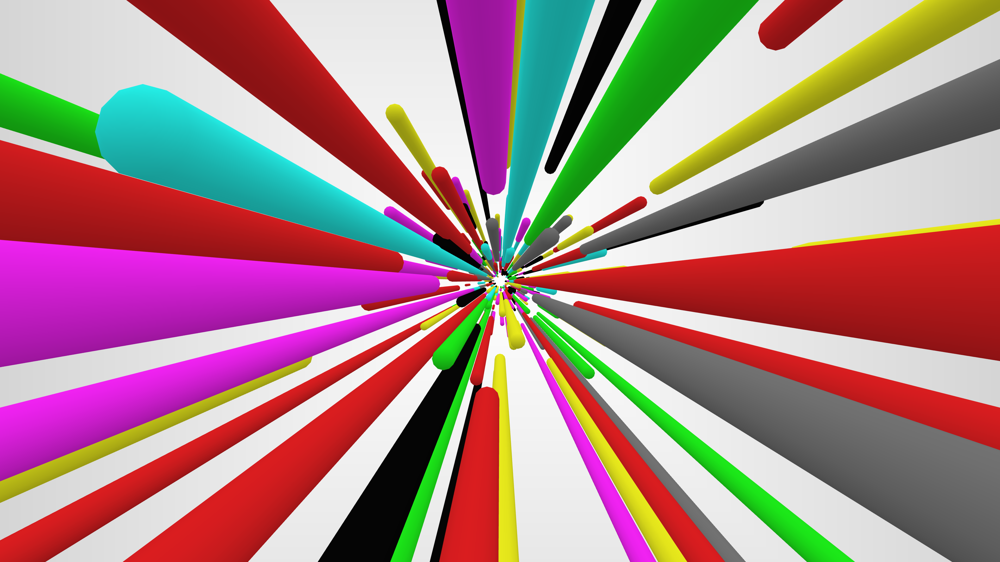

# dsh-SAO · Link Start

dsh仿刀剑神域游戏进入动画，以 Worker、OffscreenCanvas 和 WebGL 播放，并保留原始桐人 Link Start 语音与 NerveGear 启动音效。动画结束后恢复完整 DSH 界面。



## 安装最新版本

在 **DSH → 插件 → 添加插件 → 包名/仓库名** 中输入：

```text
github:GXinnnnnn/dsh-SAO
```

仓库根目录是已构建的 Cordis bundle，无需先构建或运行安装脚本。该地址安装默认分支在安装时的内容，不表示自动更新。升级请替换已有插件，避免同时启用副本；包名为 `@local/dsh-sao-link-start`，bundle 节点为 `sao-link-start`。`private: true` 不影响 GitHub 安装。

当前版本为 *纯启动动画**。已通过真实 DSH 的早期注入、独立绘制、正常结束、主题基线对照和 Esc 清理检查。已构建发布包见 [最新版 Release](https://github.com/GXinnnnnn/dsh-SAO/releases/latest)。

## 播放行为

Host 在生成页面时将启动脚本前置注入 HTML head。脚本立即创建不透明白色遮罩，覆盖 DSH 内容窗口，遮住后台界面加载；前端继续初始化时，独立 Worker 绘制彩色胶囊场景。桐人语音和启动音效通过同一 AudioContext 预先排程，两段起点相隔 1 秒，场景同样在语音开始约 1 秒后推进。

- 初始桌面窗口隐藏时，等待窗口可见才启动动画时钟和声音。
- **Esc** 可随时跳过，并停止声音、结束 Worker、清理动画资源。右上角“跳过”可通过悬停或键盘 Tab 聚焦显示。
- 浏览器阻止自动声音时，只显示临时“点击有声播放”提示；点击后从头开始这次开场，完成后提示随动画一起消失。
- 系统启用“减少动态效果”或无法取得 WebGL 时，使用约 0.9 秒静态无声开场。缺少 Worker／OffscreenCanvas 的浏览器退回主线程 WebGL，前端繁忙时的流畅性会受主线程影响。
- 没有常驻控件、设置面板、角色选择、偏好保存或主题配色。旧版本留下的偏好不参与本次播放，也不会被插件读取后应用或改写。

覆盖范围是 **DSH 内容窗口**。插件不能先于 Electron 原生窗口或 Host 就绪运行，也不能强制操作系统全屏；窗口化使用时覆盖该窗口的网页区域。

## 还原与 4K

保留原包的粒子分布、七种基础颜色、胶囊网格、顶点明暗和相机方程。镜头匀速，透视形成迎面加速感；白色背景和实体圆柱独立退场。每次播放采用时间种子。

已在独立浏览器验证 3840×2160 物理画布，以及 150%、200% 缩放对应的 4K 画布。渲染按时间推进，最大 2 倍像素密度，像素预算约 1660 万；不承诺所有设备达到固定帧率

这张历史对照验证同种子、同时间的原生场景数学移植，不是 3.0.0 Host 集成验收。D3D9 与 WebGL 在抗锯齿、边缘和部分重叠面存在差异，不宣称逐像素相同。音频保留原始字节；选用的 1 秒声画衔接偏移尚未证明为原程序精确常量。参数与原始哈希见 [SOURCE.md](SOURCE.md)。

## 源码与重建

- [index.js](index.js)：Host 入口，监听 `webserver/index-inject`，在 head 前置内联启动脚本。
- [startup.js](startup.js)：预构建启动脚本，内嵌渲染器、Worker 和两段已校验原始 WAV。
- [source/startup.template.js](source/startup.template.js)：早期遮罩、声音排程、可见性、回退与清理。
- [source/worker.js](source/worker.js)：独立动画时钟和 OffscreenCanvas 绘制。
- [source/renderer.js](source/renderer.js)：原生参数、粒子、网格及 WebGL 渲染器。
- [source/build.py](source/build.py)：Python 标准库重建，验证 WAV 哈希后合并脚本。
- [cordis.patch.yml](cordis.patch.yml)：Cordis bundle 定义。

实现不使用 `dsh.client`、React、slots 或 theme 服务。预构建成品可直接安装；自行重建需要原始 SAO ZIP，公开仓库不包含完整 ZIP、DLL 或原程序：

```sh
python source/build.py --archive /path/to/SAO.zip
```

当前 16 项独立浏览器检查通过，包括早期遮罩、原声排程、完成与 Esc 清理、回退、物理 4K、无主题／存储修改，以及主线程停顿时 Worker 继续绘制。1200ms 主线程阻塞实验记录 244 帧、最大帧间隔 17.5ms；这是单次测试结果，不是所有硬件的性能保证。另有 9 项真实 DSH 检查通过；旧版客户端入口已迁移，前端模块图和页面不再包含旧版 SAO 按钮、设置或主题层。

## 素材与许可

这是非官方爱好者项目，与 SAO 权利 或 DeepSeek 没有隶属或背书关系。新编写的集成代码使用 MIT；第三方原声、提取的图标、相关角色及商标不在该许可内，未确认其再分发授权，不能把整包视为 MIT。

图标来自 SAOHF.exe 的原始图标资源，保留提取的 ICO 和 256×256 PNG，公开包不含来源 EXE。来源与哈希见 [第三方说明](THIRD_PARTY_NOTICES.md)，许可范围见 [LICENSE](LICENSE)。
