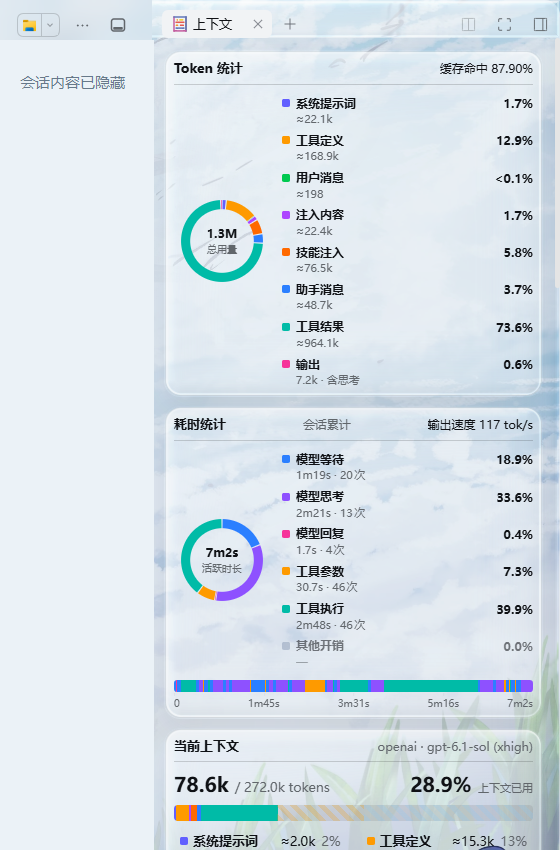
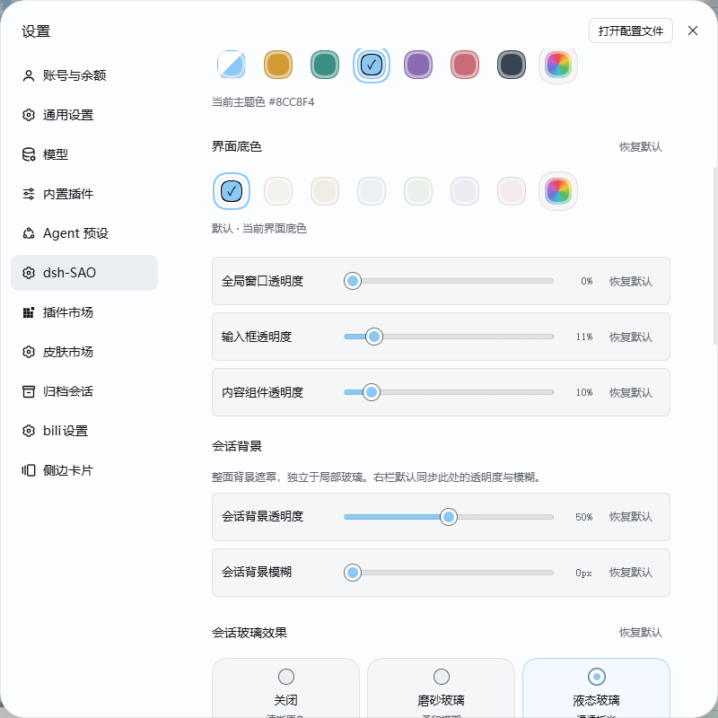
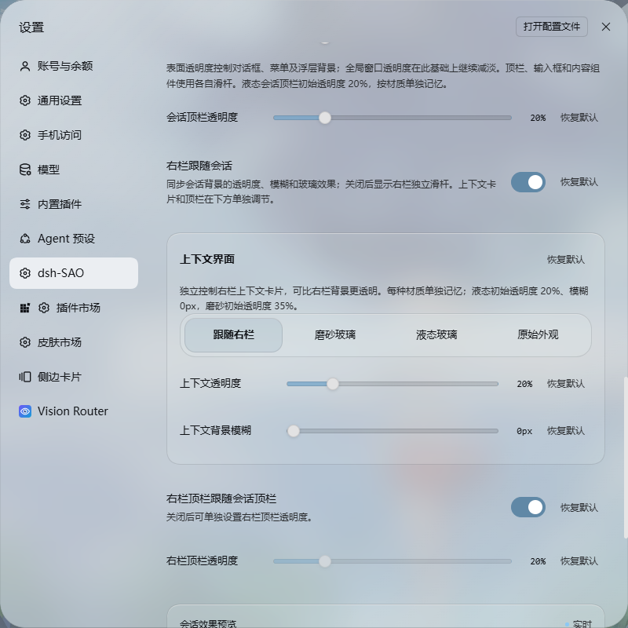
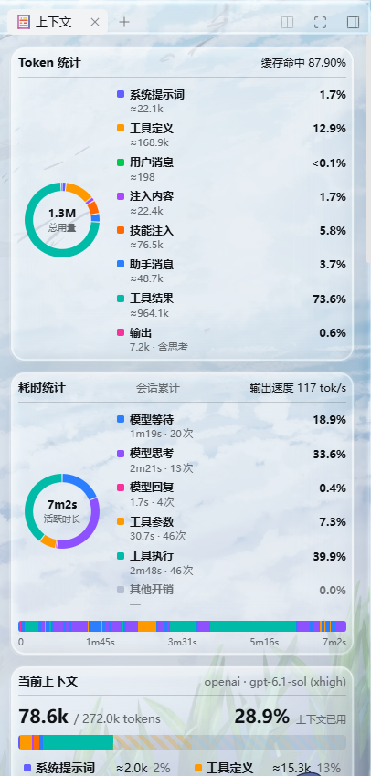
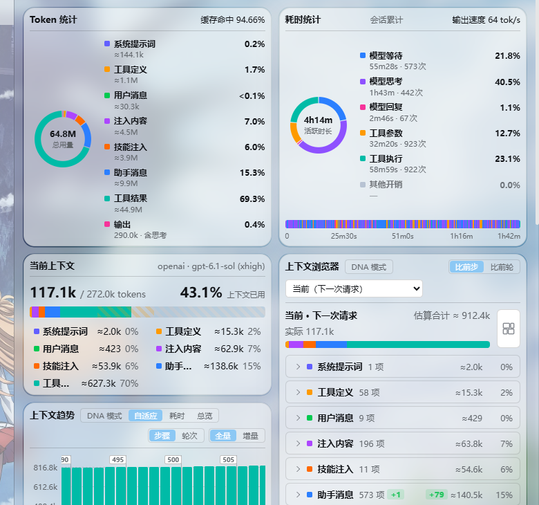
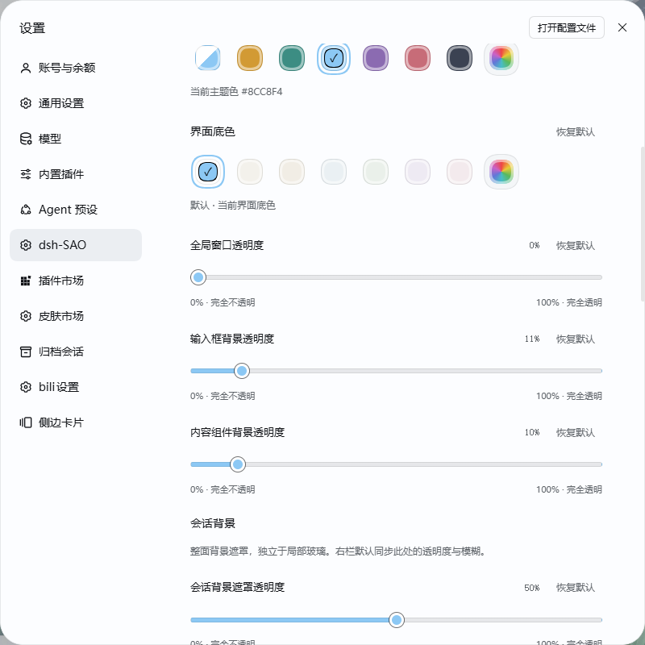
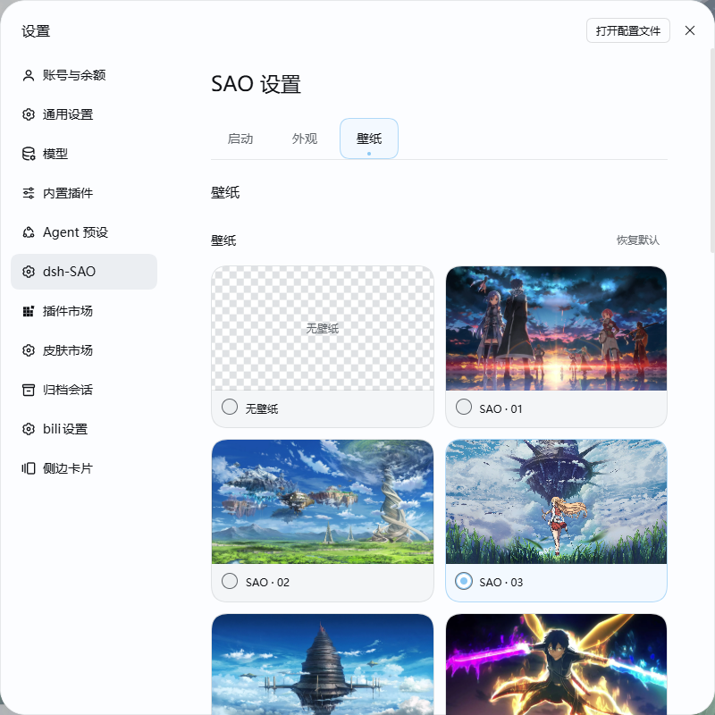

# dsh-SAO

刀剑神域风格 DSH 皮肤，提供双 Link Start 启动动画与角色语音、独立透明度、连续右栏液态玻璃与上下文叠层、主题配色、自定义壁纸和模型强度调节。



*当前工作区右栏局部实拍；会话区域已遮蔽。*

## 安装

在 **DSH → 插件 → 添加插件 → 包名/仓库名** 中输入：

```text
github:GXinnnnnn/dsh-SAO
```

安装后，在 **DSH 设置 → dsh-SAO** 中调整启动、外观和壁纸。

也可使用功能相同的市场适配包。两种安装方式请选择一种；切换前停用或移除已有副本。

```text
github:GXinnnnnn/dsh-SAO#main&path:/market
```

升级后刷新 DSH 页面。已保存的个人设置会保留。

## 启动动画与声音

- 两种启动动画：动画 1 与纤细光束动画 2，动画卡片内可查看预览图。
- 桐人／亚丝娜 Link Start 语音，搭配 NerveGear 启动音效。
- 可开关自动播放和声音，调整音量，也可手动预览。
- 按 **Esc** 或点击“跳过”结束本次播放。
- 浏览器限制自动声音时，点击提示即可有声播放；减少动态效果模式下使用静态无声开场。

## 外观与配色

- 明暗模式：跟随系统、浅色、深色。
- 主题色：默认浅蓝 **#8CC8F4**，支持预设配色、取色板和六位 HEX 自定义颜色。
- 界面底色：沿用原色，或选择柔白、暖砂、雾蓝、雾绿、淡紫、浅粉及自定义颜色；与主题色分别设置。
- 玻璃效果：关闭、液态玻璃、磨砂玻璃。液态玻璃在壁纸边缘呈现更明显的折射、弯曲和高光；磨砂玻璃以柔和的模糊扩散呈现雾面质感。
- 字体：读取并选择本机已安装的字体，也可手动输入字体名称；默认优先使用“方正兰亭圆_准”，未安装时使用回退字体。



全局窗口、输入框、内容组件、会话背景和顶栏可分别调节透明度。内容组件包括编辑摘要、交付卡、团队任务板、后台任务详情，以及会话中的“继续目标”等触发卡片。触发卡片悬停时，背景透明度增加 **5 个百分点**，文字保持清晰。

整个任务面板采用 DSH 原生进行中目标条的背景、模糊和边缘材质。

| 设置 | 默认值 |
| --- | --- |
| 全局窗口透明度 | 0% |
| 输入框背景透明度 | 10% |
| 内容组件背景透明度 | 10% |
| 会话背景透明度／模糊 | 50%／0px |
| 会话与右栏顶栏透明度 | 60%，默认联动 |
| 液态／磨砂表面透明度 | 60%／50% |
| 右栏独立液态背景透明度／模糊 | 30%／0px |
| 右栏独立磨砂背景透明度／模糊 | 50%／0px |
| 上下文液态卡片透明度／模糊 | 20%／0px |
| 上下文磨砂卡片透明度／模糊 | 35%／0px |

透明度 **0% 为完全不透明，100% 为完全透明**。输入框和内容组件的背景独立于会话背景。

右栏默认跟随主会话的背景透明度、模糊和玻璃效果；关闭后，透明度和模糊按材质独立记忆。首次独立时使用上表默认值，切换材质或重新关闭跟随会继续使用该材质已保存的参数；单项重置恢复当前材质的默认值。

右栏的上下文、文件、变更、任务管理器、侧边聊天、诊断等标签页统一使用所选背景材质；浏览器标签页保持原有外观。液态模式在整个右栏内容区铺设连续背景，带有周边高光和壁纸折射；磨砂模式呈现柔和扩散。主会话与右栏使用相同调节范围：透明度 **0–100%**，背景模糊 **0–24px**。

并排停靠的右栏展开时，与主会话在内侧平直衔接，不显示分隔线或重复圆角；外侧保留圆角与边缘高光。浏览器、悬浮与全屏面板保留各自外框。

“上下文界面”仅作用于右栏上下文卡片，默认跟随右栏的玻璃模式，也可单独选择液态玻璃、磨砂玻璃或原始外观。四个选项采用 40px 高的单行紧凑按钮，窄面板自动换行。上下文的透明度和模糊独立于右栏整面背景，按材质记忆；单项重置恢复当前材质的默认值。

液态上下文卡片叠在连续右栏背景之上，卡片下方、卡片之间的留白及圆角外侧均保留完整背景。卡片叠层会补偿背景着色，减少叠加后过度不透明；边缘折射取样同一着色背景，使卡片与背景自然衔接。磨砂上下文卡片各自铺设一层雾面材质，留白继续显示右栏背景。

右栏顶栏有独立的“跟随会话顶栏”开关，与右栏背景联动分别控制。









*全局窗口、输入框、内容组件与会话背景分别调节。*

## 壁纸

- 内置九张壁纸，默认选中 **SAO · 03**，也可选择不使用壁纸。
- 支持上传 JPG、PNG、WebP、AVIF、GIF；单张最大 25 MB、4000 万像素。
- 水平与垂直位置均可调至 **0–100%**，画面缩放 **100–250%**。
- 壁纸不透明度 **0–100%**，与玻璃和会话背景透明度分别设置。
- 可一键重置位置与大小，或删除自定义壁纸。

自定义壁纸仅保存在当前浏览器，不上传到服务器。皮肤偏好和壁纸按浏览器与站点地址保存，更换浏览器、访问端口或清除站点数据后可能需要重新设置。



*内置壁纸可直接预览和切换；上传、位置与缩放控制位于同页下方。*

## 模型强度与设置

- 输入区提供模型强度滑条，按当前模型支持的档位显示；保留模型选择器。
- 滑条支持鼠标与键盘调节，显示当前档位；无可用档位时隐藏，只有一个档位时不可调节。
- 透明度、模糊等滑条采用柔和分隔的紧凑行，依次显示标签、滑条、当前值和重置；窄面板自动换行，不重复显示两端的 0／100 标签。
- 各项设置支持单独重置，也可恢复全部默认设置。
- 单项重置输入框或内容组件背景，可恢复为默认透明度 **10%**。
- 恢复默认会将主题色设为 **#8CC8F4**、壁纸设为 **SAO · 03**；删除已上传图片需使用单独的删除操作。

许可与素材说明：[LICENSE](LICENSE) · [THIRD_PARTY_NOTICES](THIRD_PARTY_NOTICES.md)。
