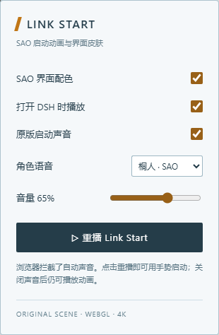
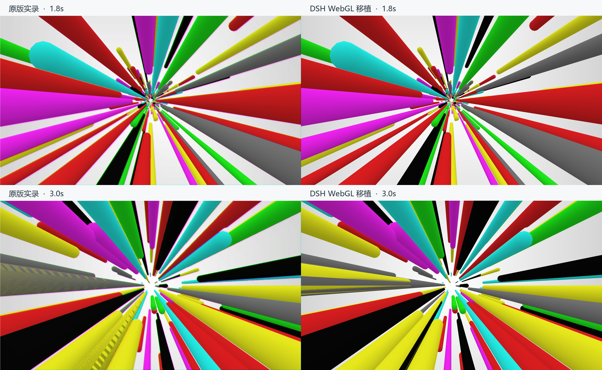

# dsh-SAO · Link Start

仿刀剑神域开屏动画。将 SAO Utils 的彩色三维启动场景移植到 DeepSeek Harness（DSH），提供原生 WebGL 穿越动画、角色语音、轻量配色和左侧 **SAO** 控制按钮。


## 安装

已构建的 Cordis bundle，仓库根目录就是插件，不需要先构建或运行安装脚本。在 DSH 插件管理器中添加以下安装源，或使用 CLI：

```sh
dsh plugin add github:GXinnnnnn/dsh-SAO#v2.0.1
```

也可以从 [Releases](https://github.com/GXinnnnnn/dsh-SAO/releases) 下载 `dsh-SAO.tgz`，通过 DSH 的插件管理器安装。若管理器要求提交引用，使用对应版本的完整 commit SHA。根据返回的 `application` / `nextStep` 刷新页面或重启；`applied` 才表示已应用。

包名 `@local/dsh-sao-link-start`，bundle 节点 `sao-link-start`。保留与 2.0.0 相同的包名和设置键，升级时请替换已有版本，避免并行启用副本。`private: true` 表示不向 npm 发布，不影响 GitHub 安装。

## 使用

- 打开 DSH 时播放一次；点击左下角 **SAO** 打开设置，面板向右展开。
- 可重播、切换桐人／亚丝娜、调整音量，分别开关自动播放、声音和界面配色。
- **Esc** 随时结束动画并停止声音；“跳过”按钮在右上角悬停或通过 Tab 聚焦时显示。
- 窄屏面板按可用高度滚动；与鲸鱼余额挂件相交时会避开其占位。
- 系统启用“减少动态效果”或无法使用 WebGL 时，使用 0.9 秒静态无声开场。
- 浏览器阻止自动声音时，点击有声重播即可。偏好仅存于当前浏览器。
- 停用插件会撤销配色层、移除样式和事件，停止声音并释放 WebGL 资源。



动画在 DSH 客户端加载插件后播放，不替换 Electron 原生启动窗口。测试宿主为 DSH **0.2.1-rc.5 / Windows / Edge**；其他 DSH 版本尚未验证。

## 还原与 4K

按原包的粒子分布、七种基础颜色、胶囊网格、顶点明暗和相机方程移植。镜头匀速，透视形成迎面加速感；白色背景和实体圆柱独立退场。正式播放像原版一样使用时间种子，不固定每次布局。

3840×2160 原生画布，验证过 100%、150%、200% 显示缩放；根据真实时间推进，最大 2 倍像素密度，像素预算约 1660 万。不承诺所有设备都达到固定帧率。



D3D9 与 WebGL 在抗锯齿、边缘和部分重叠面的光栅化上有差异，不宣称逐像素相同。声音字节未改动；声画衔接选用角色语音结束后开始场景，尚未证明是原程序精确声画延迟。参数、RVA、哈希和方法见 [SOURCE.md](SOURCE.md)。

## 源码与重建

- [client.js](client.js)：自包含客户端，使用 DSH 自带 React。
- [source/renderer.js](source/renderer.js)：粒子、网格、原生参数及 WebGL 渲染器。
- [source/client.template.js](source/client.template.js)：面板、声音、配色和生命周期。
- [source/build.py](source/build.py)：Python 标准库重建，校验原始 WAV 哈希后内嵌声音。
- [cordis.patch.yml](cordis.patch.yml)：bundle 定义，使用正式 `shell.overlay` 和 theme token 接口。

成品可直接使用。若自行重建，需自行提供原始 SAO ZIP；仓库不包含原始完整 ZIP、DLL 或原程序：

```sh
python source/build.py --archive /path/to/SAO.zip
```

2.0.1 将控制按钮由右侧移到左侧，文字由 LS 改为 SAO。原版场景渲染器、原始声音和原有偏好保持兼容。独立浏览器验证覆盖 20 项播放、音频、清理、回退与 4K 检查；真实 DSH 集成验证另覆盖左侧按钮、面板展开、宿主加载、播放与窄屏操作。

## 素材与许可

这是非官方爱好者项目，与 SAO 权利方、GPBeta 或 DeepSeek 没有隶属或背书关系。SAO Utils / NERvGear 来源与声音归属见 [THIRD_PARTY_NOTICES.md](THIRD_PARTY_NOTICES.md)。

本项目为混合许可内容：新编写的 DSH 集成代码使用 MIT；内嵌的第三方声音、相关角色及商标不在该许可内，未确认其再分发授权，不能把整包视为 MIT 或据此获得第三方素材使用权。详见 [LICENSE](LICENSE)。

## 市场收录

GitHub 是直接安装源。社区插件市场与皮肤市场分别维护收录仓库，提交 PR 并不等于已上架；维护者合并后才会进入相应目录。DSH 官方 Discover 显示用户主动添加的索引，并没有面向所有默认安装自动启用的公共市场。
