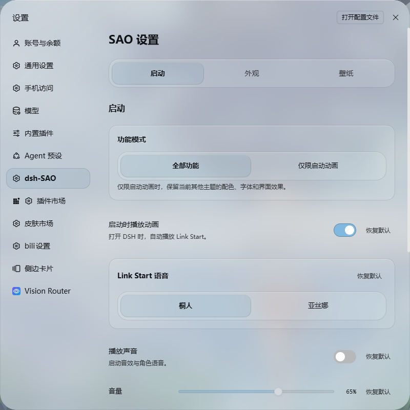
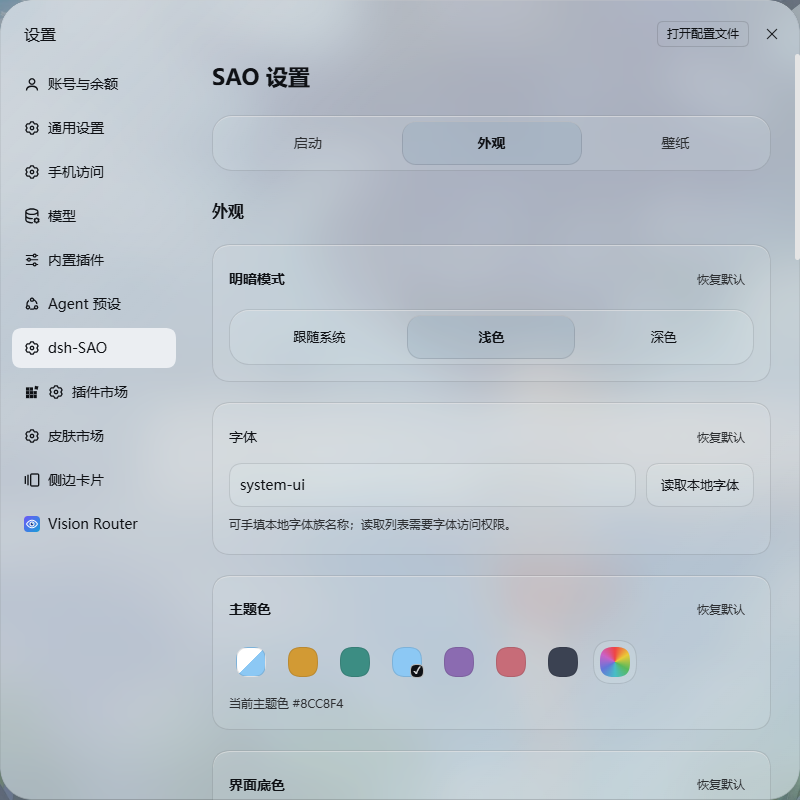

# dsh-SAO

当前版本 **1.0.6** · [正式发布与安装包](https://github.com/GXinnnnnn/dsh-SAO/releases/tag/v1.0.6)

1.0.6 提供还原 Link Start 启动动画、桐人／亚丝娜语音、音量与即时预览，支持普通窗口、超宽屏、竖屏和播放中的窗口缩放。界面包含液态／磨砂玻璃、明暗独立配色、完整设置主题、本地图片／循环视频壁纸和模型思考强度调节。

刀剑神域风格 DSH 皮肤，提供原生还原 Link Start 启动动画与角色语音、独立透明度、连续右栏玻璃与上下文叠层、分级控件状态、主题配色、本地图片／循环视频壁纸和模型思考强度调节。


*当前工作区右栏局部实拍；会话区域已遮蔽。*

## 安装

在 **DSH → 插件 → 添加插件 → 包名/仓库名** 中输入：

```text
github:GXinnnnnn/dsh-SAO
```

安装后，在 **DSH 设置 → dsh-SAO** 中调整启动、外观和壁纸。

也可使用功能相同的市场适配包。两种安装方式请选择一种；切换前停用已有副本。

```text
github:GXinnnnnn/dsh-SAO#main&path:/market
```

安装后刷新 DSH 页面。已保存的个人设置会保留。

## 功能模式

**启动设置的第一项**为左右排列的双选项：左侧“全部功能”，右侧“仅限启动动画”。默认使用全部功能。

- **全部功能**：启用启动动画、主题配色、字体、玻璃、控件状态、壁纸和强度滑条。
- **仅限启动动画**：只提供启动动画、角色语音、音量与预览；不接管配色、字体、玻璃、壁纸或模型滑条，可与其他皮肤一起使用。切换即时生效，已保存的外观参数保留。



## 启动动画与声音

- 默认播放原生还原 Link Start 启动动画，可点击“预览启动动画”直接体验。
- 桐人／亚丝娜 Link Start 语音，搭配 NerveGear 启动音效；语音选择紧接启动开关。
- 可开关自动播放和声音，调整音量，也可手动预览。
- 主界面在启动动画下方正常加载；收尾时先将白底逐渐转为真实透明通道，光线继续叠在界面上播放。光线降到约一两成后再淡出并同步收尾声音，自然衔接软件界面。
- 点击动画中的**任意位置**或按 **Esc** 即可结束本次播放；跳过按钮始终可见。
- 浏览器限制自动声音时显示提示，点击仍会跳过；减少动态效果模式下使用静态无声开场。


## GUI 适配

- 启动动画适配普通窗口、21:9／32:9 超宽屏和竖屏。光束以原生比例投影，超宽画面按比例铺满，保持线条的形状与空间纵深。
- 播放时跟随窗口缩放、横竖屏切换及可视视口变化重新计算画布；白底透明过渡、光线淡出与跳过操作使用同一视口。
- 设置页按实际内容区宽度调整布局，适配窄侧栏和弹窗；语音、音量及预览控制保持可达，分段选项和滑条可自适应换行。
- 减少动态效果、键盘焦点和点击／Esc 跳过均可用。

## 外观与配色

药丸按钮、开关和选项采用分级底色与玻璃边缘高光。未选中、悬停、按下、已选中具有不同深浅；选中开关保留明显的滑块位置，键盘焦点可见，危险操作使用原生语义色。原生账号菜单使用默认样式；从左下角“我的”打开的整个设置窗口共用 SAO 主题色与轻玻璃样式，包括导航和其他设置分类。

插件页的紧凑开关在启用时使用轻主题色填充与均匀细描边，滑块保留清楚的位置差异；关闭态呈现中性底色。悬浮提示、菜单和弹窗根据当前位置的实际背板呈现玻璃：普通白底或深色页面跟随当前页面，覆盖其他弹窗时跟随下层弹窗；只在确实覆盖可见壁纸的区域使用壁纸折射，离开会话或隐藏会话后不保留旧取样。

会话顶部“对话／轨迹／上下文／编队／统计”使用贴近文字的紧凑胶囊按钮，圆润轮廓与顶栏下沿之间留有空隙。标签组本身透明，未选中项仅带极淡底色；选中项使用轻主题色、均匀的 1px 细边与柔和高光。底部 token 输出速度、缓存命中和上下文占比保持单行、主文字色与较粗字重；窄窗口可横向滚动，避免换行后被裁掉。

设置页采用与右栏上下文适配一致的玻璃风格：32px 大圆角外框、带少量当前主题色的半透明底、柔和背景模糊与细高光。主题色会同步混入分组和控件的玻璃底，呈现轻透质感。内部使用 22px 圆角的轻玻璃分组与共用宽底框的分段选项卡，文字选项等宽分布。点击后，加深的圆角选中底块以 **加减速平移**定位，快速连续切换时从当前位置接续；键盘方向键可切换，系统减少动态效果时直接定位。实际设置弹窗共用一层玻璃，避免重复底色和模糊叠加。

- 明暗模式：跟随系统、浅色、深色。
- 主题色：默认浅蓝 **#8CC8F4**，支持预设配色、取色板和六位 HEX 自定义颜色。**明亮与深色模式分别记忆颜色**，切回时自动恢复；跟随系统时按系统当前明暗模式使用对应颜色。“跟随 DSH”也分别保存，升级时保留现有配色。
- 界面底色：跟随软件主题底色，或选择柔白、暖砂、雾蓝、雾绿、淡紫、浅粉及自定义颜色；与主题色分别设置。
- 玻璃效果：关闭、液态玻璃、磨砂玻璃。液态玻璃使用平整中心与弧形边缘的独立光学截面，结合方向性高光、内侧反光和局部轻微色散，让边缘呈现厚度而不放大整张卡片；磨砂玻璃保留柔和的模糊扩散和雾面质感。折射仅取当前可见的壁纸场景；其他页面使用当前页面的原生背景模糊与细高光，不会带入会话壁纸。
- 字体：读取并选择本机已安装的字体，也可手动输入字体名称；默认优先使用“方正兰亭圆_准”，未安装时使用回退字体。

液态玻璃的实现方法与来源对照见 [光学说明](source/LIQUID_OPTICS.md)：参考 Three.js、Drei 等渲染资料独立实现，采用单个共享渲染器和按需重绘。



全局窗口、输入框、内容组件、会话背景和顶栏可分别调节透明度。内容组件包括编辑摘要、交付卡、团队任务板、后台任务详情，以及会话中的“继续目标”等触发卡片。触发卡片悬停时，背景透明度增加 **5 个百分点**，文字保持清晰。

整个任务面板采用 DSH 原生进行中目标条的背景、模糊和边缘材质。

| 设置 | 默认值 |
| --- | --- |
| 全局窗口透明度 | 0% |
| 输入框背景透明度 | 10% |
| 内容组件背景透明度 | 10% |
| 会话背景透明度／模糊 | 50%／0px |
| 会话与右栏顶栏透明度 | 液态20%／磨砂60%，默认联动 |
| 液态／磨砂表面透明度 | 20%／50% |
| 右栏独立液态背景透明度／模糊 | 30%／0px |
| 右栏独立磨砂背景透明度／模糊 | 50%／0px |
| 上下文液态卡片透明度／模糊 | 20%／0px |
| 上下文磨砂卡片透明度／模糊 | 35%／0px |

透明度 **0% 为完全不透明，100% 为完全透明**。输入框和内容组件的背景独立于会话背景。

右栏默认跟随主会话的背景透明度、模糊和玻璃效果；关闭后，透明度和模糊按材质独立记忆。首次独立时使用上表默认值，切换材质或重新关闭跟随会继续使用该材质已保存的参数；单项重置恢复当前材质的默认值。

右栏的上下文、文件、变更、任务管理器、侧边聊天、诊断等标签页统一使用所选背景材质；浏览器标签页使用原生外观。液态模式在整个右栏内容区铺设连续背景，带有周边高光和壁纸折射；磨砂模式呈现柔和扩散。主会话与右栏使用相同调节范围：透明度 **0–100%**，背景模糊 **0–24px**。

并排停靠的右栏展开时，与主会话在内侧平直衔接，不显示分隔线或重复圆角。右栏背景的右上角在停靠与全屏布局中均保持直角，与原生边框对齐；其余外侧圆角与边缘高光保留。浏览器、悬浮与全屏面板保留各自外框。

“上下文界面”仅作用于右栏上下文卡片，默认跟随右栏的玻璃模式，也可单独选择液态玻璃、磨砂玻璃或原始外观。四个选项在同一宽底框内等宽排列，以加减速平移的底块标识当前选择，窄面板内文字可自适应换行。上下文的透明度和模糊独立于右栏整面背景，按材质记忆；单项重置恢复当前材质的默认值。

液态上下文卡片叠在连续右栏背景之上，卡片下方、卡片之间的留白及圆角外侧均保留完整背景。卡片叠层会补偿背景着色，减少叠加后过度不透明；边缘折射取样同一着色背景，使卡片与背景自然衔接。磨砂上下文卡片各自铺设一层雾面材质，留白继续显示右栏背景。

右栏顶栏有独立的“跟随会话顶栏”开关，与右栏背景联动分别控制。


*全局窗口、输入框、内容组件与会话背景分别调节。*

## 壁纸

- 内置九张壁纸，默认选中 **SAO · 03**，也可选择不使用壁纸。
- **壁纸显示范围可切换**：在 **设置 → dsh-SAO → 壁纸 → 壁纸显示范围** 中选择“全界面”或“仅限会话”，默认“全界面”。
- **全界面**：壁纸覆盖会话与右侧边栏。
- **仅限会话**：壁纸在会话区域居中填充，不延伸到右侧边栏；右栏以软件当前明暗主题的界面底色作为纯色背景，并跟随自定义界面底色。右栏液态折射同步此范围，不会重新带出壁纸。
- 图片支持 JPG、PNG、WebP、AVIF、GIF；单张最大 25 MB、4000 万像素。
- 视频支持浏览器可解码的 **MP4／WebM**，静音循环播放；单个最大 **200 MiB、30 秒**，支持 **4K（3840×2160）与 5K（5120×2880）**，长边不超过 **5120px**、短边不超过 **2880px**，横竖屏均可。建议使用 24–30fps 的短循环素材；不会对上传文件转码。
- 上传并选中视频壁纸时展开“视频播放”，可选**自动循环**或**静态省电**；使用图片、内置壁纸或无壁纸时收起。页面隐藏、窗口失焦或壁纸不透明度为 0 时暂停；系统开启减少动态效果时仅显示封面并卸载视频源。解码／播放失败时显示封面。
- 仅在当前使用视频壁纸时加载一个原生视频播放器；静态省电、切走壁纸或切到仅限启动动画时卸载视频源。玻璃折射取样视频封面，不逐帧更新折射纹理。
- 水平与垂直位置均可调至 **0–100%**，画面缩放 **100–250%**。
- 壁纸不透明度 **0–100%**，与玻璃和会话背景透明度分别设置。
- 可一键重置位置与大小，或删除自定义壁纸。

自定义壁纸仅保存在当前浏览器，不上传到服务器。皮肤偏好和壁纸按浏览器与站点地址保存，更换浏览器、访问端口或清除站点数据后可能需要重新设置。


*内置壁纸可直接预览和切换；上传、位置与缩放控制位于同页下方。*

## 模型强度与设置

- 输入区提供模型强度滑条，按当前模型支持的档位显示，配合模型选择器使用。
- 切换模型后即可拖动强度滑条；服务商未声明默认强度时，显示可选择的“服务商默认”，无需先打开原生模型选项。仅在用户提交调节时保存强度。
- 滑条支持鼠标与键盘调节，显示当前档位；无可用档位时隐藏，只有一个档位时不可调节。
- 透明度、模糊等滑条采用柔和分隔的紧凑行，依次显示标签、滑条、当前值和重置；窄面板自动换行，不重复显示两端的 0／100 标签。
- 各项设置支持单独重置，也可恢复全部默认设置。单独重置主题色只影响当前明暗模式；恢复全部默认设置会重置明暗两套配色。
- 单项重置输入框或内容组件背景，可恢复为默认透明度 **10%**。
- 恢复默认会将主题色设为 **#8CC8F4**、壁纸设为 **SAO · 03**；删除已上传图片或视频需使用单独的删除操作。

许可与素材说明：[LICENSE](LICENSE) · [THIRD_PARTY_NOTICES](THIRD_PARTY_NOTICES.md)。
