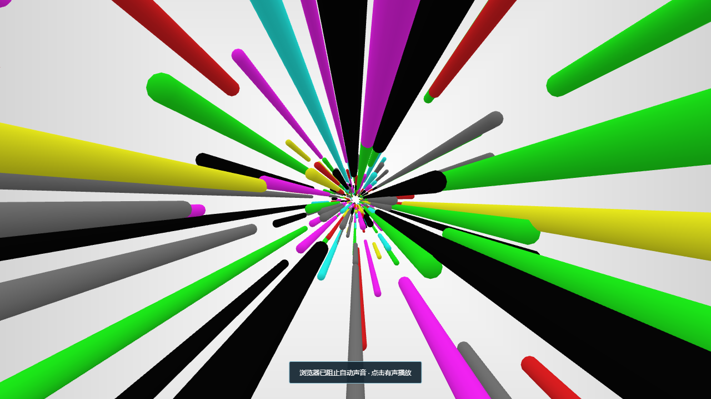

# dsh-SAO

DSH 皮肤市场适配包：只播放仿刀剑神域启动动画和原声，结束后显示 DSH。没有主题覆盖、设置或常驻控件。



在 DSH 添加插件中安装此子目录，或者使用 DSH Skin Market 中的 dsh-SAO：

```text
github:GXinnnnnn/dsh-SAO#main&path:/market
```

市场会为安装目标锁定真实提交。不要同时启用仓库根目录包和此适配包，切换前停用或移除原副本。

Host 在前端模块启动之前注入遮罩和声音；Web 客户端提供完整的播放回退和卸载清理。两个入口使用同一个文档级播放标记，Host 已开始或完成时，客户端不会重复播放。Esc 可跳过，动画结束会清理画面、Worker、GPU、声音和事件。

覆盖 DSH 内容窗口，不能先于原生窗口或 Host 就绪，不能强制操作系统全屏。浏览器音频策略可能要求点击后播放声音。

本包由仓库根目录的 `source/build-market.py` 从同一 `startup.js` 生成。内部 package 版本用于安装系统，展示名称固定为 dsh-SAO。场景、原声和提取图标与根目录包相同。新集成代码为 MIT，第三方原声和提取图标不在该许可内，授权情况见 LICENSE 和 THIRD_PARTY_NOTICES.md。本项目不代表 DSH、市场或原素材权利方背书。
